# Design: word9: offline Flutter app with the same features as Nine Tile

## 1. Scope

- **Spec:** [word9: offline Flutter app with the same features as Nine Tile](/feature-word9-flutter-app.md)
- **Spec type:** Feature
- **Related:** [Implementation plan](/feature-word9-flutter-app-plan.md), [ADR: word-data pipeline](/adr/adr-word-data-pipeline.md)
- **Sub-system grain:** Container, with the app's modules as components, because almost every story happens inside the app.
- **Status baseline:** New, Changed and Unchanged are relative to `opichon/word9` @ `main` (`34d58ac`), where plan steps 1 to 7 are merged.
- **Codebase scope:**
  - `opichon/ninetile` @ `main` (`3543b45`): read-only reference for behaviour.
  - `opichon/word9` @ `main` (`34d58ac`)

## 2. Key

| Notation | Meaning |
| -------- | ------- |
| AC, B, C, EC, R, US | Spec references, numbered as in section 3 of the [test plan](/feature-word9-flutter-app-test-plan.md): acceptance criterion, boundary, constraint, edge case, rollout exit criterion, user story |
| Colour of a participant | No meaning: set by the renderer |
| Dashed arrow | Response |
| Numbered circle | Step number, cited by the notes |
| Outer box | Boundary of the software system |
| Solid arrow, closed head | Synchronous request |
| Solid arrow, open head | Asynchronous message |

## 3. System context

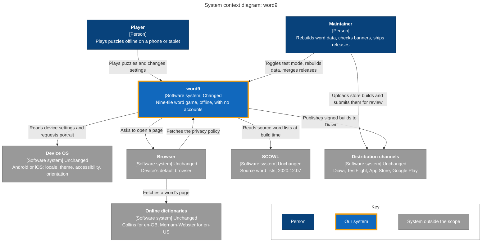

- Nine Tile isn't here: it's a reference for behaviour, with no link at build time or run time (C-22).
- The Player's only path to the network is through the Browser (C-6).

## 4. Sub-systems

```mermaid
---
title: "Container diagram: word9"
config:
  flowchart:
    wrappingWidth: 320
---
flowchart TB
  player["<b>Player</b><br/>[Person]<br/>Plays puzzles offline"]:::person
  maintainer["<b>Maintainer</b><br/>[Person]<br/>Checks banners, rebuilds data, ships"]:::person
  subgraph system["word9 [Software system]"]
    app["<b>word9 app</b><br/>[Container: Flutter, Dart] Changed<br/>Runs the game, settings and test mode, with bundled fonts"]:::changed
    assets[("<b>word-data assets</b><br/>[Container: JSON files in the app package] Unchanged<br/>Words, puzzles, test pool and dictionary address, per variant")]:::unchanged
    saved[("<b>Saved state</b><br/>[Container: shared_preferences] New<br/>Saved game and level per variant, active variant, test mode")]:::new
    tool["<b>word-data tool</b><br/>[Container: Python scripts] Unchanged<br/>Builds the assets and checks them against the contract and digests"]:::unchanged
    release["<b>release</b><br/>[Container: GitHub Actions workflows] Changed<br/>Tests, signs and publishes builds, publishes the policy"]:::changed
    policy["<b>Privacy policy page</b><br/>[Container: static page on GitHub Pages] New<br/>States that word9 collects no data"]:::new
  end
  os["<b>Device OS</b><br/>[Software system] Unchanged<br/>Locale, theme, accessibility, orientation"]:::external
  browser["<b>Browser</b><br/>[Software system] Unchanged<br/>Device's default browser"]:::external
  dictionaries["<b>Online dictionaries</b><br/>[Software system] Unchanged<br/>Collins, Merriam-Webster"]:::external
  scowl["<b>SCOWL</b><br/>[Software system] Unchanged<br/>Source word lists"]:::external
  channels["<b>Distribution channels</b><br/>[Software system] Unchanged<br/>Diawi, TestFlight, App Store, Google Play"]:::external
  player -->|"Plays by tapping"| app
  maintainer -->|"Long-presses the title"| app
  maintainer -->|"Runs a rebuild on demand<br/>[Python]"| tool
  maintainer -->|"Merges to main<br/>[GitHub]"| release
  maintainer -->|"Uploads store builds and submits them<br/>[App Store Connect, Play Console]"| channels
  app -->|"Loads the active variant<br/>[rootBundle, off the UI thread]"| assets
  app -->|"Reads and writes state<br/>[shared_preferences]"| saved
  app -->|"Reads device settings and requests portrait<br/>[Flutter platform API]"| os
  app -->|"Asks to open a page<br/>[url_launcher, external application]"| browser
  tool -->|"Reads word lists<br/>[HTTPS, on demand]"| scowl
  tool -->|"Writes and checks the files<br/>[JSON files]"| assets
  release -->|"Runs the data checks<br/>[Python]"| tool
  release -->|"Publishes the page<br/>[GitHub Pages]"| policy
  release -->|"Publishes signed builds to Diawi<br/>[HTTPS API]"| channels
  browser -->|"Fetches a word's page<br/>[HTTPS]"| dictionaries
  browser -->|"Fetches the policy<br/>[HTTPS]"| policy
  subgraph key["Key"]
    direction LR
    kp["Person"]:::person ~~~ ku["Unchanged"]:::unchanged ~~~ kh["Changed"]:::changed ~~~ kn["New"]:::new ~~~ ke["System outside the scope"]:::external
  end
  channels ~~~ key
  classDef person fill:#08427b,stroke:#052e56,color:#fff
  classDef unchanged fill:#438dd5,stroke:#2e6295,color:#fff
  classDef changed fill:#438dd5,stroke:#f59e0b,stroke-width:4px,color:#fff
  classDef new fill:#438dd5,stroke:#22c55e,stroke-width:4px,color:#fff
  classDef external fill:#999,stroke:#6b6b6b,color:#fff
  style system fill:none,stroke:#666,stroke-dasharray:6 4
  style key fill:none,stroke:#999
```

- No cycles. No arrow leaves `word9 app` for the network: it has no `INTERNET` permission (C-6).
- The assets are committed, so `release` needs neither SCOWL nor a rebuild to ship the app (see the [ADR](/adr/adr-word-data-pipeline.md)).

| Sub-system | Status | Location | Stories |
| ---------- | ------ | -------- | ------- |
| Browser | External | Device | US-5, US-7 |
| Device OS | External | Device | US-7 |
| Distribution channels | External | Diawi, App Store Connect, Play Console | R-1 |
| Online dictionaries | External | collinsdictionary.com, merriam-webster.com | US-5 |
| Privacy policy page | New | New: `word9/docs/` | US-7, R-1 |
| `release` | Changed | `word9/.github/workflows/`, `word9/android/`, `word9/ios/` | C-23, R-1 |
| Saved state | New | New: app sandbox on the device, through `shared_preferences` | US-1 to US-4, US-6 to US-8 |
| SCOWL | External | wordlist.aspell.net | C-23 |
| `word-data` assets | Unchanged | `word9/assets/words/` | US-6, US-7, C-23 |
| `word-data` tool | Unchanged | `word9/tool/` | C-23 |
| `word9 app` | Changed | `word9/lib/` | US-1 to US-8 |

## 5. Components

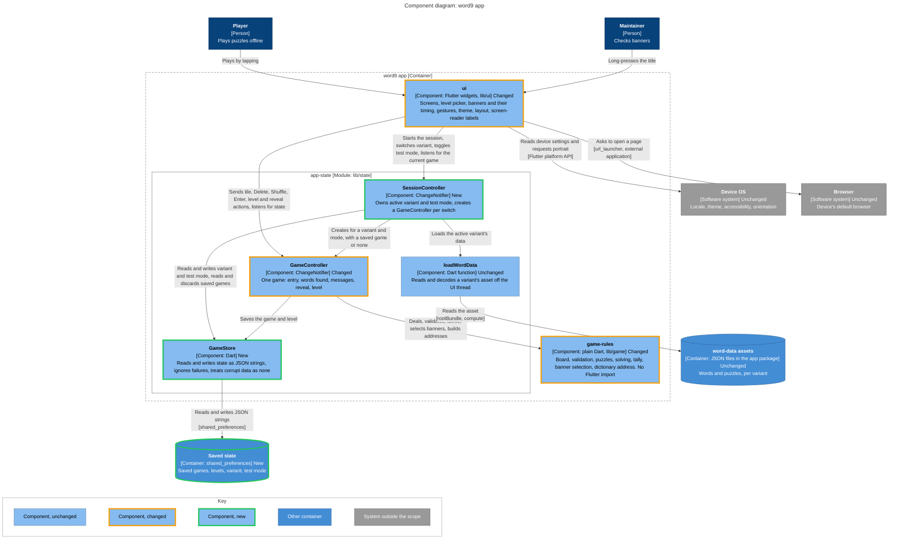

- One way only: `ui` → `app-state` → `game-rules`. `ui` learns of changes by listening, not through calls back.
- State lives in the controllers, above the widgets, so a rotation rebuilds the layout and keeps the letters and message (EC-16).
- `GameController` stays one game for one variant and mode, so a switch replaces it rather than resetting its fields.

## 6. Workflows

### US-1: Play a puzzle by tapping

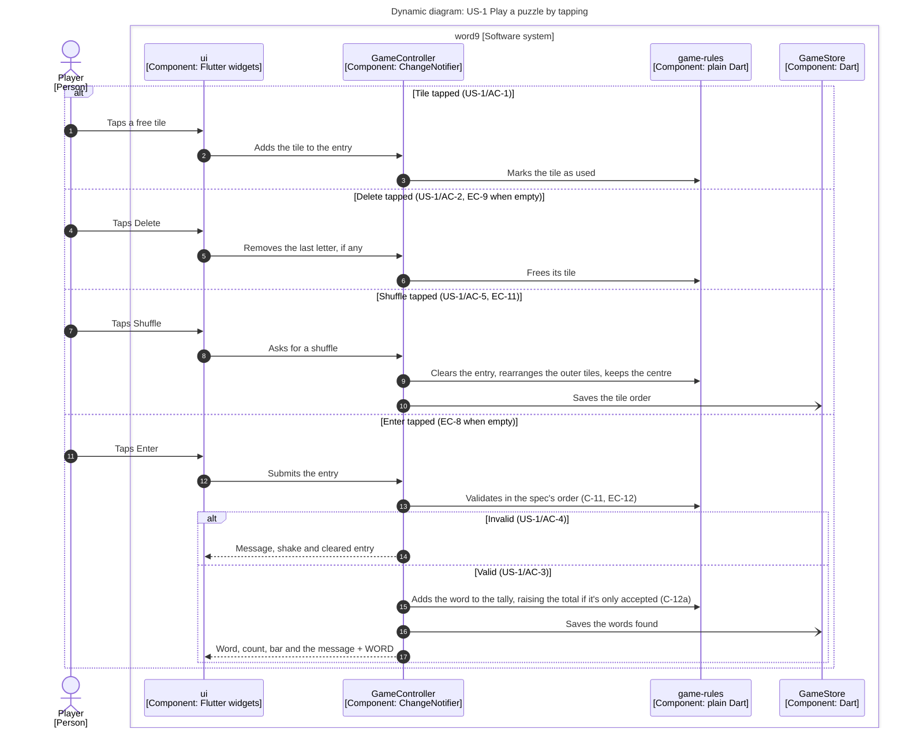

- `ui` has no keyboard handling at all, so no input arrives except tiles and buttons (B-1).
- Step 13 checks the centre by tile position, not by letter, which is how EC-12 is rejected.
- Tile taps and deletes aren't saved, because the letters being entered don't survive a kill (EC-1). `ui` rebuilds from each change by listening.

### US-2: Choose a level

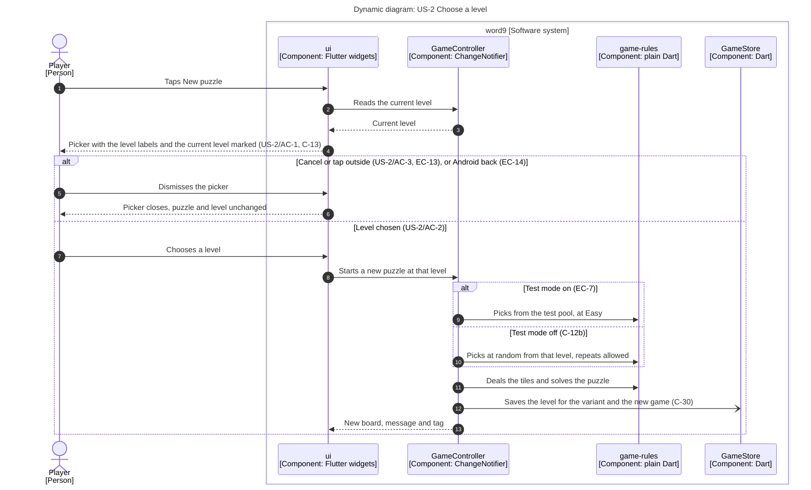

### US-3: See progress and encouragement

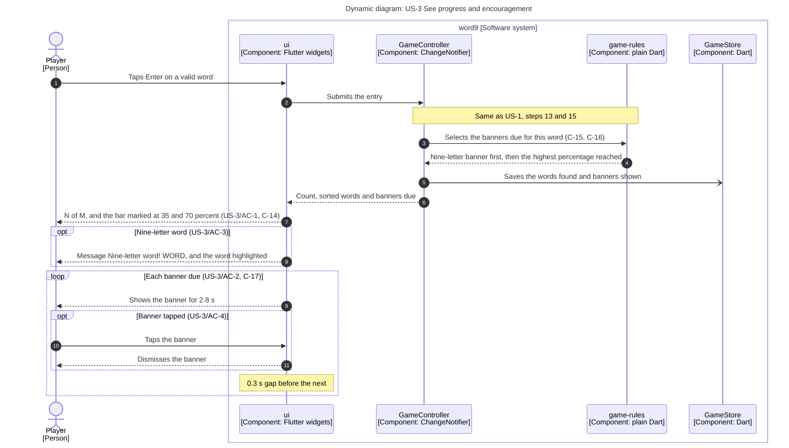

- `game-rules` decides which banners show, and `ui` decides how long: the timing is presentation, behind a replaceable clock for tests.

### US-4: Reveal all words

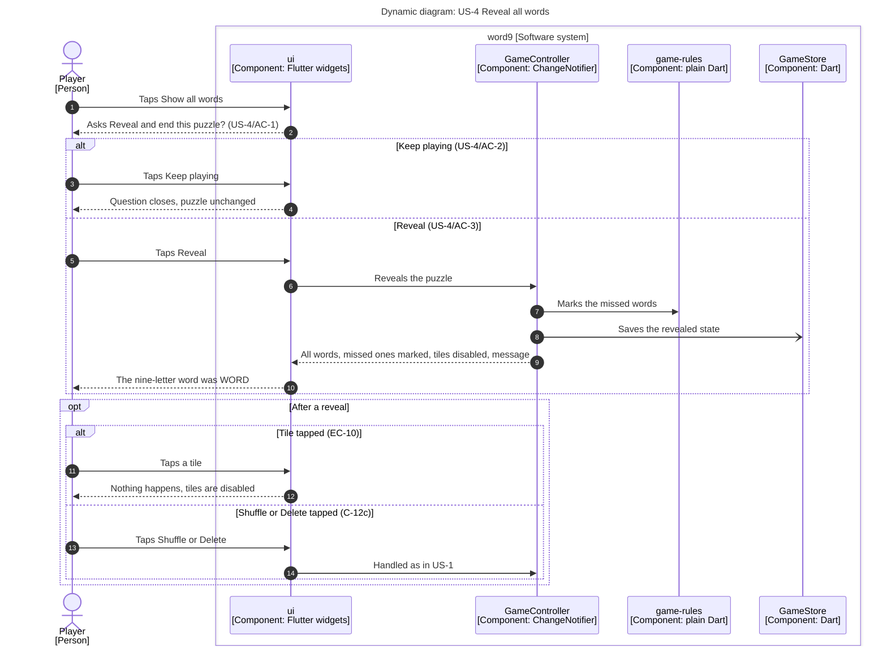

### US-5: Look up a word

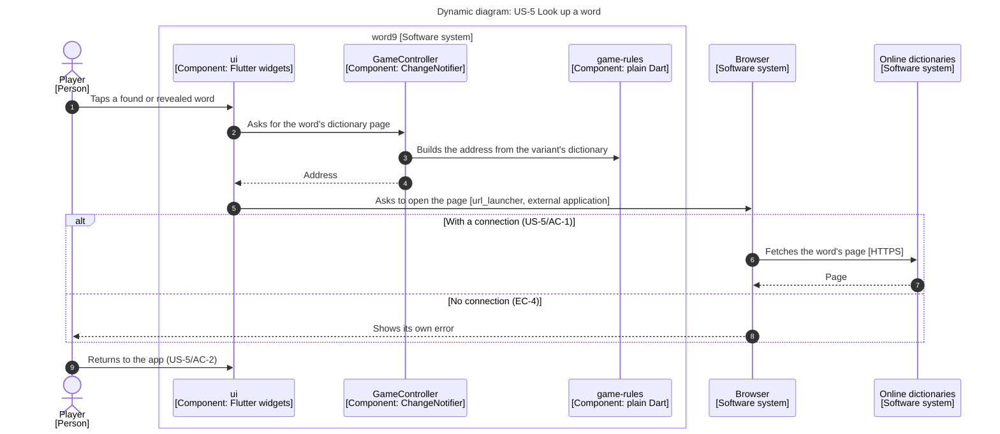

- Steps 1 to 5 change no game state, and the app makes no request itself (C-6).
- The OS may kill the app while the browser is in front. It then comes back as in US-6, so the game is still unchanged.

### US-6: Play offline and resume

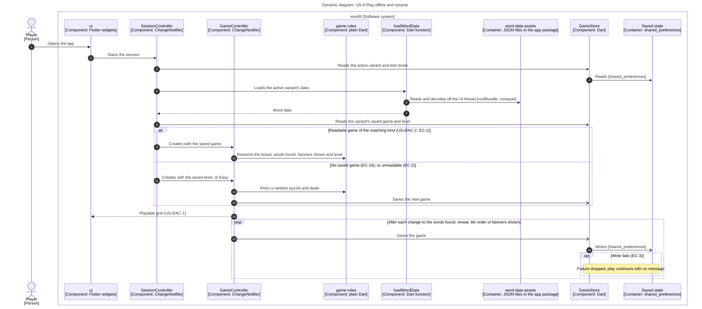

- Steps 1 to 14 use only the device: no network and no sign-in (C-5, C-7). They are the 3 s cold start (C-36), which is why the decoding runs off the UI thread.
- Step 15 saves on each change rather than when the app goes to the background, because a killed app may never get that signal (EC-1).
- Only the active variant's data is loaded (see the [ADR](/adr/adr-word-data-pipeline.md)).

### US-7: Choose English variant

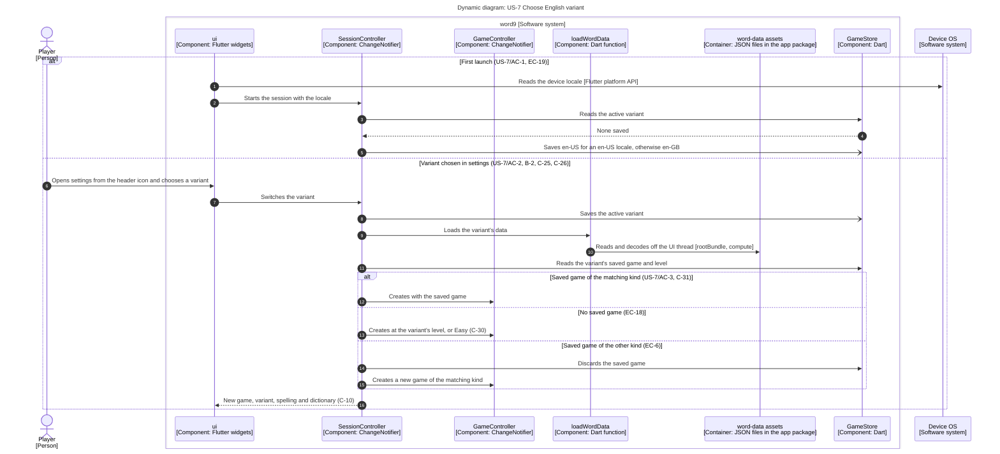

- Steps 7 to 16 are the 500 ms variant switch (C-37). The asset is decoded again each time, which the [ADR](/adr/adr-word-data-pipeline.md) accepts until it's measured.
- `SessionController` disposes of the previous `GameController` at step 16. That game's last save is already in Saved state.
- After steps 1 to 5, a first launch goes on as in US-6, steps 5 to 14.

### US-7, settings entries

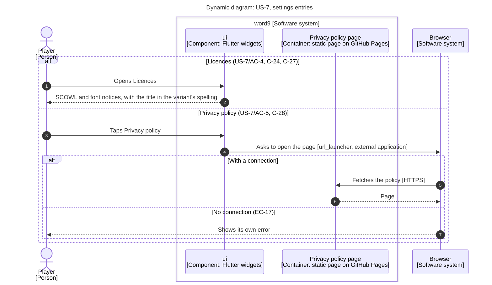

- `ui` adds no back handler on the main and settings screens, so the OS's normal behaviour applies (EC-15).

### US-8: Check banners with test mode

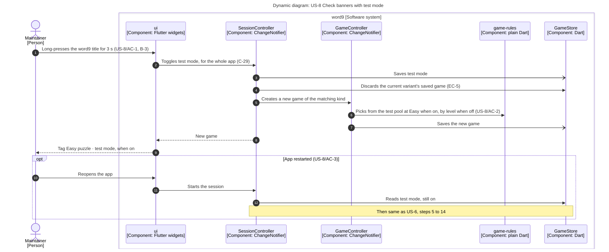

### C-22, C-23: Build word data

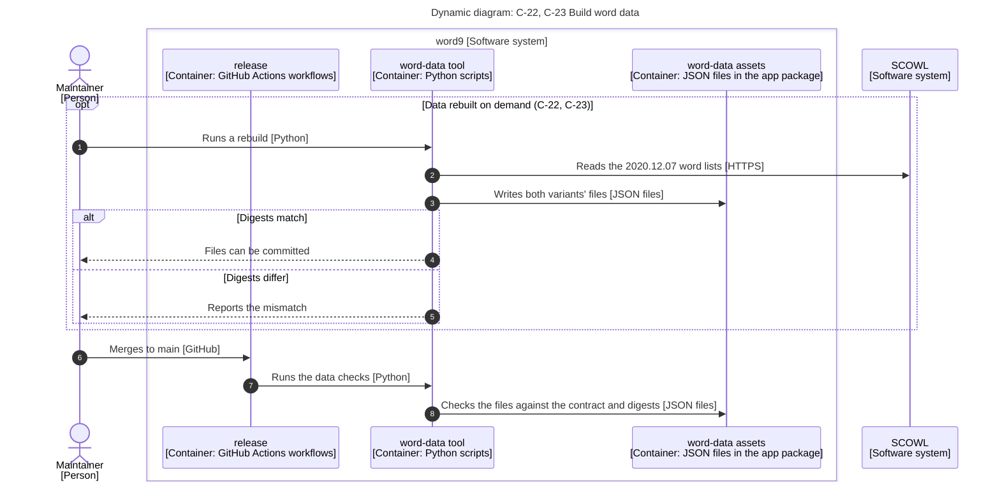

- Changing a word rule on purpose means updating word9's stored digests, as the two apps may then differ (see the [ADR](/adr/adr-word-data-pipeline.md)).

### R-1 to R-4: Publish builds

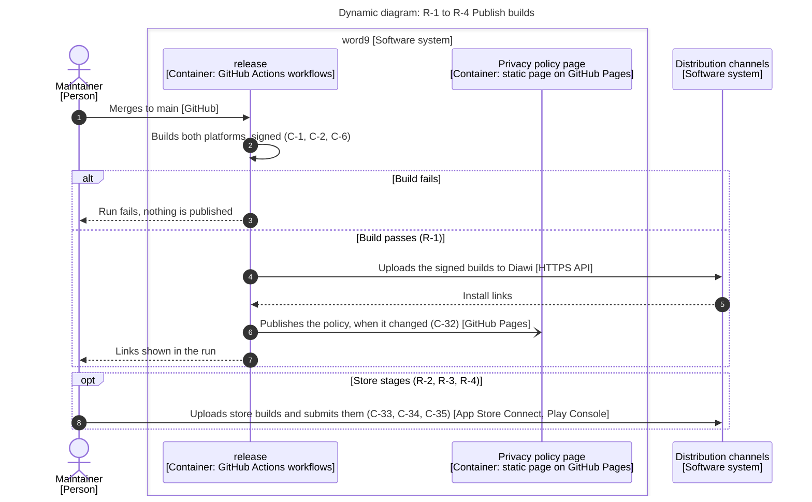

- Signing keys and the Diawi token are only available to the workflow on `main`, never to pull requests, which are public (plan decision).
- All automated tests run on the pull request before the merge, so step 1 only publishes what passed.

> **Open question:** Are store uploads manual or from CI? The plan decides this only for Diawi. Step 8 assumes manual uploads; moving them to `release` would add an arrow and more secrets, and nothing else.

## 7. Deployment

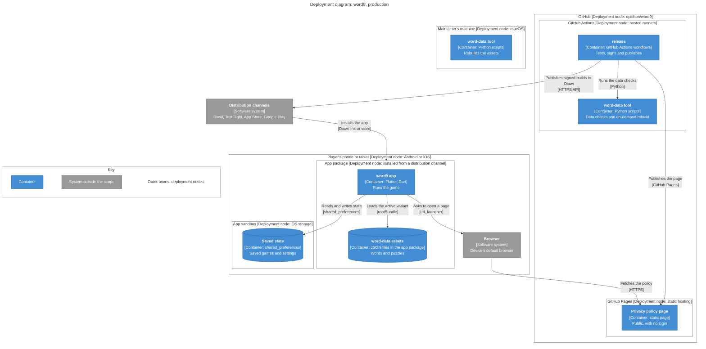

- Everything the game needs sits inside the phone node: the only link out of it is through the Browser (C-5).
- The same build reaches every channel stage of the spec's rollout, apart from its signing, so this diagram holds for Diawi, TestFlight and both stores.

## 8. Design decisions

| Choice | Options and trade-offs | Decision | Shapes | For the plan |
| ------ | ---------------------- | -------- | ------ | ------------ |
| App state | `ChangeNotifier`: built in, enough for this state Riverpod: stronger structure, every layer on the package Bloc: explicit events, most boilerplate | `ChangeNotifier`, by the owner, in the plan | Section 5 | None |
| Opening pages | External browser app: clearest fit with "no network requests", and the player leaves the app In-app browser tab: smoother return, but the page appears inside word9, so the no-network claim is harder to show in review | External browser app, by the owner: it fits C-6 most plainly | Sections 4 and 5, US-5, US-7 | Feasibility: the Android manifest needs a query for `https` links, with no `INTERNET` permission added |
| Owner of variant and test mode | New `SessionController` above `GameController`: `GameController` stays one game, and `ui` listens to two objects Extend `GameController`: `ui` listens to one object, but settings mix with the game, and each switch resets fields by hand | New `SessionController`, by the owner: a switch can't leak state from the previous game | Section 5, US-6, US-7, US-8 | None: local and easy to change, and the plan's steps 15 and 16 gain this component |
| Publishing to Diawi | Automated from CI on each merge: always current, with signing keys in GitHub secrets Manual upload: credentials stay out of CI, but a person must remember | Automated from CI, by the owner, in the plan | Section 4, R-1 | None |
| Storage | `shared_preferences`: closest to Nine Tile's `localStorage` JSON file: atomic writes and corruption are ours to handle SQLite: transactions and queries that aren't needed | `shared_preferences`, by the owner, in the plan | Sections 4 and 5, US-6 | None |
| Store uploads | Manual: no more secrets, and a person is already reviewing these stages From CI: repeatable, with store credentials in GitHub secrets | Open; the diagrams assume manual | Section 4, R-1 to R-4 | None |
| Word-data pipeline | Python tool, JSON assets: proven exact match, decode time unmeasured Dart tool: one language, the match must be proven again Prebuilt SQLite: fast, with a native dependency Generated Dart constants: no loading, slow builds | Python tool and JSON assets, by the owner, in the [ADR](/adr/adr-word-data-pipeline.md) | Section 4, US-6, US-7, C-23 | ADR exists. Feasibility: JSON decoding against C-36 and C-37 on the spec's devices, which are not available yet (plan step 20) |

## 9. Coverage

| Spec item | Summary | Where | Sub-systems |
| --------- | ------- | ----- | ----------- |
| US-1/AC-1 | Tap adds a letter, tile used | US-1, steps 1 to 3 | `word9 app` |
| US-1/AC-2 | Delete frees a tile | US-1, steps 4 to 6 | `word9 app` |
| US-1/AC-3 | Valid word found | US-1, steps 11 to 13, 15 to 17 | `word9 app`, Saved state |
| US-1/AC-4 | Invalid entry | US-1, steps 11 to 14 | `word9 app` |
| US-1/AC-5 | Shuffle | US-1, steps 7 to 10 | `word9 app`, Saved state |
| US-2/AC-1 | Picker with the current level | US-2, steps 1 to 4 | `word9 app` |
| US-2/AC-2 | Choose a level | US-2, steps 7 to 13 | `word9 app`, Saved state |
| US-2/AC-3 | Cancel the picker | US-2, steps 5 and 6 | `word9 app` |
| US-3/AC-1 | Count, bar, sorted list | US-3, steps 6 and 7 | `word9 app` |
| US-3/AC-2 | Milestone banner | US-3, steps 3, 4, 9 | `word9 app` |
| US-3/AC-3 | Nine-letter word | US-3, steps 4, 8 | `word9 app` |
| US-3/AC-4 | Dismiss a banner | US-3, steps 10 and 11 | `word9 app` |
| US-4/AC-1 | Reveal question | US-4, steps 1 and 2 | `word9 app` |
| US-4/AC-2 | Keep playing | US-4, steps 3 and 4 | `word9 app` |
| US-4/AC-3 | Reveal | US-4, steps 5 to 10 | `word9 app`, Saved state |
| US-5/AC-1 | Dictionary opens | US-5, steps 1 to 7 | `word9 app`, Browser, Online dictionaries |
| US-5/AC-2 | State kept after return | US-5, step 9 | `word9 app` |
| US-6/AC-1 | Fresh install offline | US-6, steps 1 to 14 | `word9 app`, `word-data` assets, Saved state |
| US-6/AC-2 | Kill and reopen | US-6, steps 1 to 10, 14 | `word9 app`, Saved state |
| US-7/AC-1 | Default variant | US-7, steps 1 to 5 | `word9 app`, Device OS, Saved state |
| US-7/AC-2 | Choose a variant | US-7, steps 6 to 16 | `word9 app`, `word-data` assets, Saved state |
| US-7/AC-3 | Resume or new on a switch | US-7, steps 11 to 15 | `word9 app`, Saved state |
| US-7/AC-4 | Licences | US-7 settings entries, steps 1 and 2 | `word9 app` |
| US-7/AC-5 | Privacy policy opens | US-7 settings entries, steps 3 to 6 | `word9 app`, Browser, Privacy policy page |
| US-8/AC-1 | Long-press toggle | US-8, steps 1 to 8 | `word9 app`, Saved state |
| US-8/AC-2 | Test pool and tag | US-8, steps 6, 9 | `word9 app` |
| US-8/AC-3 | Test mode persists | US-8, steps 10 to 12 | `word9 app`, Saved state |
| EC-1 | Killed mid-word | US-6, steps 9 and 10, and the note on US-1 | `word9 app`, Saved state |
| EC-2 | Corrupt save | US-6, steps 11 to 13 | `word9 app`, Saved state |
| EC-3 | Storage write fails | US-6, opt under step 16 | `word9 app`, Saved state |
| EC-4 | Dictionary with no connection | US-5, step 8 | Browser |
| EC-5 | Test mode toggled | US-8, steps 4 and 5 | `word9 app`, Saved state |
| EC-6 | Variant switch, kind mismatch | US-7, steps 14 and 15 | `word9 app`, Saved state |
| EC-7 | Level chosen in test mode | US-2, step 9 | `word9 app` |
| EC-8 | Enter on an empty entry | US-1, alt at step 11: `GameController` ignores it | `word9 app` |
| EC-9 | Delete on an empty entry | US-1, step 5 | `word9 app` |
| EC-10 | Tile after a reveal | US-4, steps 11 and 12 | `word9 app` |
| EC-11 | Shuffle with letters | US-1, step 9 | `word9 app` |
| EC-12 | Outer tile with the centre's letter | US-1, step 13 | `word9 app` |
| EC-13 | Picker dismissed | US-2, steps 5 and 6 | `word9 app` |
| EC-14 | Android back on the picker | US-2, steps 5 and 6 | `word9 app` |
| EC-15 | Android back elsewhere | Note on US-7 settings entries | `word9 app`, Device OS |
| EC-16 | Rotation | Section 5, note on state | `word9 app` |
| EC-17 | Privacy policy with no connection | US-7 settings entries, step 7 | Browser |
| EC-18 | No saved game for the variant | US-6, steps 11 to 13; US-7, step 13 | `word9 app` |
| EC-19 | First launch locale | US-7, steps 1 to 5 | `word9 app`, Device OS |
| B-1 | No keyboard input | Note on US-1 | `word9 app` |
| B-2 | Language setting | US-7, steps 6 to 16 | `word9 app` |
| B-3 | Test mode gesture | US-8, step 1 | `word9 app` |
| C-1 | Flutter on Android and iOS | Section 4, `word9 app`; R-1, step 2 | `word9 app`, `release` |
| C-2 | Minimum OS | R-1, step 2 | `release` |
| C-3 | Portrait lock | Section 5, `ui` to Device OS | `word9 app`, Device OS |
| C-4 | Centred width, scrolling | Section 5, `ui` | `word9 app` |
| C-5 | Airplane mode | US-6, steps 1 to 14; section 7, phone node | `word9 app`, `word-data` assets, Saved state |
| C-6 | No network requests | Section 4, note; US-5, note | `word9 app`, Browser |
| C-7 | No account | US-6, note | `word9 app` |
| C-8 | No analytics, ads, reporting, purchases | Section 4: no such system or arrow | `word9 app` |
| C-9 | Parity of rules and validation | Section 5, `game-rules`; C-23 | `word9 app` |
| C-10 | Text and spelling | US-7, step 16; section 5, `ui` | `word9 app` |
| C-11 | Validation order | US-1, step 13 | `word9 app` |
| C-12a | Accepted word raises the total | US-1, step 15 | `word9 app` |
| C-12b | Puzzle can repeat | US-2, step 10 | `word9 app` |
| C-12c | Shuffle and Delete after a reveal | US-4, steps 13 and 14 | `word9 app` |
| C-13 | Level labels | US-2, step 4 | `word9 app` |
| C-14 | Progress | US-3, step 7 | `word9 app` |
| C-15 | Banners once per puzzle | US-3, steps 3 to 5 | `word9 app`, Saved state |
| C-16 | Highest banner, nine-letter first | US-3, steps 3 and 4 | `word9 app` |
| C-17 | Banner timing | US-3, step 9 and the note in the loop | `word9 app` |
| C-18 | Palettes, system theme | Section 5, `ui` to Device OS | `word9 app`, Device OS |
| C-19 | Fonts and layout | Section 4, `word9 app`; section 5, `ui` | `word9 app` |
| C-20 | Reduced motion | Section 5, `ui` to Device OS | `word9 app`, Device OS |
| C-21 | Screen reader | Section 5, `ui` | `word9 app` |
| C-22 | Own word data | C-22, C-23, steps 1 to 3; section 3, note | `word-data` tool, SCOWL |
| C-23 | Exact data match | C-22, C-23, steps 1 to 5, 7 and 8 | `word-data` tool, `word-data` assets, `release` |
| C-24 | Licences | US-7 settings entries, steps 1 and 2 | `word9 app` |
| C-25 | Settings entry point | US-7, step 6 | `word9 app` |
| C-26 | Variant labels | US-7, step 6 | `word9 app` |
| C-27 | New-text spelling | US-7 settings entries, step 2 | `word9 app` |
| C-28 | Privacy policy entry | US-7 settings entries, step 3 | `word9 app` |
| C-29 | Test mode applies to the whole app | US-8, step 2; US-7, steps 14 and 15 | `word9 app`, Saved state |
| C-30 | Level per variant | US-2, step 12; US-7, step 13 | `word9 app`, Saved state |
| C-31 | Saved game per variant | US-7, steps 11 and 12 | `word9 app`, Saved state |
| C-32 | Published policy | R-1 to R-4, step 6; section 7, GitHub Pages | `release`, Privacy policy page |
| C-33 | Store privacy forms | R-1 to R-4, step 8 | Distribution channels |
| C-34 | Review notes | R-1 to R-4, step 8 | Distribution channels |
| C-35 | Icon, store materials | R-1 to R-4, step 8 | Distribution channels |
| C-36 | Cold start | US-6, note; section 8, Word-data pipeline | `word9 app`, `word-data` assets |
| C-37 | New puzzle or variant switch | US-7, note; section 8, Word-data pipeline | `word9 app`, `word-data` assets |
| C-38 | Tap or submit | US-1, step 13 is on the UI thread; measured by plan step 20 | `word9 app` |
| R-1 | Diawi install on both platforms | R-1 to R-4, steps 1 to 7 | `release`, Distribution channels |
| R-2 | Acceptance on internal-track builds | R-1 to R-4, step 8 | Distribution channels |
| R-3 | Closed test and production access | R-1 to R-4, step 8 | Distribution channels |
| R-4 | Live on both stores | R-1 to R-4, step 8 | Distribution channels |
