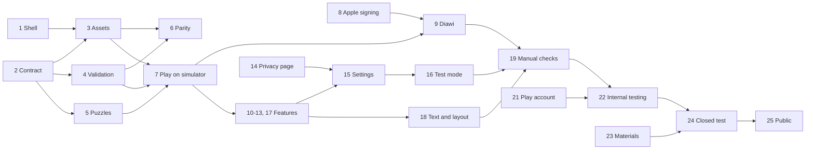

# Implementation plan: word9: offline Flutter app with the same features as Nine Tile

## 1. Scope

- **Spec:** [word9: offline Flutter app with the same features as Nine Tile](/feature-word9-flutter-app.md)
- **Spec type:** Feature
- **Delivers:** word9 on Android and iOS with Nine Tile's features, offline and with no accounts, available through Diawi as soon as it's playable, then store testing, then both public stores.
- **Test plan:** [Test plan: word9: offline Flutter app with the same features as Nine Tile](/feature-word9-flutter-app-test-plan.md)
- **Constraint:** All the tests in the test plan pass at the end of the last step, apart from NF-1, NF-2 and NF-3 while they are Blocked (see step 20).
- **Codebase scope:**
  - `opichon/ninetile` @ `main` (`3543b45`): read-only reference.
  - `opichon/word9` @ `main` (`66b664d`): specs and CI only; no app code yet, so every component in this plan is new.

## 2. Hard problems

| Problem | What's uncertain | Spec items | Settled by |
| ------- | ---------------- | ---------- | ---------- |
| Exact word-data match | Whether Nine Tile's script[^ninetile-build] still reproduces the committed data | C-22, C-23 | Planning: rebuilding from SCOWL 2020.12.07 at `3543b45` matched every field of `DATA` for both variants, on 2026-11-01 |
| Google Play production access | A new personal account can't go straight from internal testing to production[^play-testing] | R-3, R-4 | Planning: at least 12 testers for 14 days and a production application, now in the spec. The wait is in step 24 |
| Hidden test mode on iOS | Whether App Review accepts a hidden gesture[^apple-hidden] | C-34, US-8 | Planning: the gesture stays and is disclosed in the review notes. The answer comes at step 25; if Apple objects, the decision returns to the owner |
| Portrait lock on Android tablets | Android ignores the lock at 600 dp and wider for API 36 apps[^android-orientation] | C-3, C-4, EC-16 | Planning: portrait wherever the OS allows, and landscape must work. Proven by CT-8 in step 18 |
| Privacy policy | The stores need one, and the app had no place for it | C-28, C-32 | Planning: published with GitHub Pages and linked in settings. Delivered by step 14 |
| Speed on real devices | Load and solve times are unmeasured, and the spec's Pixel 6a and iPhone 11 aren't available | C-36, C-37, C-38 | Step 20 (**Blocked**). Step 7 gives an early impression on simulators; step 9 on real phones |

## 3. Technical choices

### Word-data build and format

| Option | Trade-offs | Coupling it creates |
| ------ | ---------- | ------------------- |
| Python tool adapted from Nine Tile, one JSON asset per variant | Already proven to reproduce the data; the digest applies directly; adds Python for developers; JSON decoding time unmeasured on target devices | None at run time |
| Dart tool | One language, but must be proven again, and needs a SHA-1 dependency | None |
| Prebuilt SQLite or generated Dart constants | Faster lookups or no loading, but a native dependency or slow builds | None |

- **Decision:** Python tool and JSON assets, by the owner. Prebuilt SQLite is the fallback if step 20 misses the speed targets.
- **ADR:** [ADR: word-data pipeline](/adr/adr-word-data-pipeline.md)

### App state

| Option | Trade-offs | Coupling it creates |
| ------ | ---------- | ------------------- |
| `ChangeNotifier` | Built in, no dependency, enough for one screen of state plus settings | `ui` on `app-state` only |
| Riverpod | Stronger structure and test overrides, but a dependency beyond this app's needs | Every layer on the package |
| Bloc | Explicit events and states, with the most boilerplate | Every layer on the package |

- **Decision:** `ChangeNotifier`, by the owner.
- **ADR:** Not needed: local, and easy to change behind `app-state`.

### Storage

| Option | Trade-offs | Coupling it creates |
| ------ | ---------- | ------------------- |
| `shared_preferences` | Closest to Nine Tile's `localStorage`; small JSON strings by key; one dependency | `app-state` only |
| JSON file | Full control, but atomic writes and corrupt files are ours to handle | `app-state` only |
| SQLite | Transactions and queries that aren't needed | `app-state` only |

- **Decision:** `shared_preferences`, by the owner.
- **ADR:** Not needed: nothing is published yet, and it's contained in `app-state`.

### Pull request checks

| Option | Trade-offs | Coupling it creates |
| ------ | ---------- | ------------------- |
| All automated levels on each PR | Every automated test runs before merging, including on an Android emulator and iOS simulator; slower checks | None |
| Fast checks on PR, acceptance nightly | Faster, but a failure can reach `main` and then Diawi | None |
| No emulators in CI | Cheapest, and easy to forget | None |

- **Decision:** All automated levels on each PR, by the owner. This matters more because merging also publishes to Diawi.
- **ADR:** Not needed: workflow files are easy to change.

### Diawi builds

| Option | Trade-offs | Coupling it creates |
| ------ | ---------- | ------------------- |
| Automated from CI on each merge to `main` | The team always has the latest, with no manual work; signing keys and a Diawi token go into GitHub secrets in a public repository | `release` on Diawi's upload API |
| Manual upload, after each step or phase | Credentials stay out of CI, but a person must remember | None |

- **Decision:** Automated from CI, by the owner. Secrets are only used by the `main` workflow, never on pull requests.
- **ADR:** Not needed: the workflow is easy to replace with manual uploads.

## 4. Sub-systems

| Sub-system | Location | Role in this work |
| ---------- | -------- | ------------------ |
| `word-data` | `word9/tool/`, `word9/assets/words/` | New: build tool and JSON assets |
| `game-rules` | `word9/lib/game/` | New: plain Dart rules, with no Flutter import |
| `app-state` | `word9/lib/state/` | New: `ChangeNotifier` state, saved games and settings |
| `ui` | `word9/lib/ui/` | New: screens and widgets |
| `release` | `word9/android/`, `word9/ios/`, `word9/.github/workflows/`, `word9/docs/` | New: project setup, CI, signing, Diawi, privacy page, store work |

## 5. Prerequisites

- Flutter 3.47.4 and Dart 3.13.3: met (`flutter --version`); the version is pinned in the project.
- Xcode and the Android SDK: met (both found on the owner's machine).
- App identifier `com.opichon.word9`: met (owner's decision).
- An Android phone and an iPhone for real-device checks: met (owner's answer).
- Spec and test plan merged: met for the base documents; the Diawi additions are part of this plan's pull request.

## 6. Overview

### Availability

| Steps | Available through | Who can use it |
| ----- | ----------------- | -------------- |
| 1–6 | Automated tests; an empty app shell on simulators | Developers |
| 7–8 | Simulator and emulator: the first playable game | Developers |
| 9–20 | **Diawi, on both platforms**, rebuilt on every merge | The team, on registered iPhones and any Android phone |
| 22–24 | TestFlight and the Play internal track, then the Play closed test | Testers |
| 25 | App Store and Google Play | Everyone |

### Phases

The spec has a single release, so these are the plan's own stages of work.

| Phase | Origin | Outcome | Steps | Depends on | Exit check |
| ----- | ------ | ------- | ----- | ---------- | ---------- |
| 1: Data and rules | Plan | Real word data and game rules work, proven against Nine Tile | 1–6 | None | NF-4, NF-7, IT-1, IT-2, all unit tests |
| 2: Playable on simulators | Plan | A real puzzle can be played on a simulator and emulator | 7 | 1 | AT-1, AT-2, CT-1, CT-9 |
| 3: On real devices | Plan | **Milestone: word9 installs from Diawi on both platforms** | 8–9 | 2 | NF-10 |
| 4: Complete app | Plan | Every feature in the spec works, on each new Diawi build | 10–18 | 3 | All automated tests |
| 5: Verified on devices | Plan | Manual checks pass on real phones, with speed measured once devices are settled | 19–20 | 4 | AT-15 to AT-18, NF-5; NF-1 to NF-3 when unblocked |
| 6: Store testing | Plan | TestFlight, the Play internal track and the closed test are done, with production access granted | 21–24 | 5 | R-2, R-3 |
| 7: Public | Plan | Live on both stores | 25 | 6 | R-4 |

### Steps

| Step | Phase | Deliverable | Depends on | Sub-systems | Tests |
| ---- | ----- | ----------- | ---------- | ----------- | ----- |
| 1 | 1 | App shell builds for both platforms in CI, with no `INTERNET` permission in the release build | None | `release` | NF-4, NF-7 |
| 2 | 1 | Word-data contract that consumers can test against | None | `word-data` | Contract check |
| 3 | 1 | Both variants' assets build from SCOWL and match the digests | 1, 2 | `word-data` | IT-1, IT-2 |
| 4 | 1 | Word validation, found words, dictionary address | 2 | `game-rules` | UT-1, UT-6, UT-7, UT-8 |
| 5 | 1 | New puzzle, shuffle, banner selection | 2 | `game-rules` | UT-3, UT-4, UT-5 |
| 6 | 1 | Solving matches Nine Tile on real data | 3, 4 | `game-rules`, `word-data` | UT-2 |
| 7 | 2 | Play a real puzzle by tapping, on a simulator | 1, 3, 4, 5 | `app-state`, `ui` | AT-1, AT-2, CT-1, CT-9 |
| 8 | 3 | Apple account, ad hoc signing and registered iPhones in place | None | `release` | Signed build check |
| 9 | 3 | **Each merge to `main` publishes signed builds of both platforms to Diawi** | 7, 8 | `release` | NF-10 |
| 10 | 4 | Level picker | 7 | `ui` | AT-3, AT-4 |
| 11 | 4 | Progress and banners | 7 | `ui` | AT-5, AT-6, CT-2, CT-3 |
| 12 | 4 | Reveal and dictionary links | 7 | `ui` | AT-7, AT-8, AT-9 |
| 13 | 4 | A game survives restarts; failed writes stay silent | 7 | `app-state` | IT-3, IT-4, CT-11 |
| 14 | 4 | Privacy policy live on GitHub Pages | None | `release` | NF-6 |
| 15 | 4 | Settings: variants, Licences, Privacy policy | 10, 12, 13, 14 | `app-state`, `ui` | AT-10, AT-11, AT-12, IT-5, CT-6, CT-7 |
| 16 | 4 | Test mode | 10, 15 | `app-state`, `ui` | AT-13, AT-14, IT-6, IT-7 |
| 17 | 4 | Palettes and bundled fonts | 7 | `ui` | CT-5, CT-10 |
| 18 | 4 | Final text, layout, rotation, reduced motion, screen-reader labels | 10, 11, 12 | `ui` | CT-4, CT-8, NF-8, NF-9 |
| 19 | 5 | Manual checks pass on Diawi builds on real phones | 9, 15, 16, 17, 18 | `release` | AT-15, AT-16, AT-17, AT-18, NF-5 |
| 20 | 5 | Speed targets measured (**Blocked**) | 15, 16, 17, 18 | `release` | NF-1, NF-2, NF-3 |
| 21 | 6 | Google Play account open, listing name chosen | None | `release` | Check |
| 22 | 6 | TestFlight and Play internal builds pass the acceptance criteria | 8, 19, 21 | `release` | R-2 |
| 23 | 6 | Icon, screenshots, listing text, privacy forms and review notes ready | 8, 21 | `release` | Owner review |
| 24 | 6 | Closed test done with at least 12 testers for 14 days; production access granted | 22, 23 | `release` | R-3 |
| 25 | 7 | Live on both stores | 24 | `release` | R-4 |

## 7. Independence

| Sub-systems | Relation | Contract or dependency | Reason |
| ----------- | -------- | ---------------------- | ------ |
| `word-data`, `game-rules` | Through a contract | Asset format and fixture, defined in step 2 | Rules read the data, but need nothing else from the tool |
| `word-data`, `app-state` | Sequenced | `app-state` loads the assets from step 3 | The first playable game needs real words |
| `word-data`, `ui` | Independent | | |
| `word-data`, `release` | Independent | | CI runs without SCOWL; assets are committed |
| `game-rules`, `app-state` | Sequenced | `app-state` calls the rules' public API | The state wraps the rules, a one-way dependency |
| `game-rules`, `ui` | Independent | | `ui` only goes through `app-state` |
| `game-rules`, `release` | Independent | | |
| `app-state`, `ui` | Sequenced | `ui` listens to `app-state` | After step 7, features may touch both, kept to one step each |
| `app-state`, `release` | Independent | | |
| `ui`, `release` | Sequenced | Step 9 needs something playable (step 7) to publish | Nothing else links them |

**Cycles:** None, in the work or the design. In the design, dependencies run one way: `ui` → `app-state` → `game-rules`, with data read through the asset contract. The tool has no link to the app.

| Workstream | Sub-systems | Steps | Waits for | Meets at |
| ---------- | ----------- | ----- | --------- | -------- |
| Word data | `word-data` | 2, 3, 6 | Step 1 for step 3; step 4 for step 6 | Step 6, with rules |
| Rules | `game-rules` | 4, 5 | Step 2 | Steps 6 and 7 |
| Game | `app-state`, `ui` | 7, 10–13, 15–18 | Steps 1, 3, 4, 5 | Step 7. After it, steps 10–13 and 17 can run at once |
| Delivery | `release` | 1, 8, 9, 14, 19–25 | Step 7 for step 9; the finished app for step 19 | Step 9 (Diawi milestone), step 19 |

Step 1 comes first for everyone except the contract in step 2. Steps 8, 14 and 21 can start at any time; step 8 should start early, as it holds up the Diawi milestone. The owner takes the account steps (8, 21) and the review in step 23.

## 8. Steps

### Phase 1: Data and rules

**Outcome:** Real word data and game rules work, proven against Nine Tile, and everything runs in CI. Available as automated tests and an empty shell on simulators.

#### Step 1: App shell in CI

- **Deliverable:** A `com.opichon.word9` app opens showing its title on a simulator and emulator, and CI builds Android and iOS release versions from a clean checkout, with no `INTERNET` permission in the Android release.
- **Depends on:** None
- **Sub-systems:** `release`
- **Changes:**
  - new: Flutter project with the pinned Flutter version, and exact dependency versions in `pubspec.yaml`.
  - new: PR workflow running analysis, tests, both release builds, and a smoke acceptance test on an Android emulator and iOS simulator.
  - `.github/dependabot.yml`: add the `pub` ecosystem.
- **Tests to pass:** NF-4, NF-7, written by this step.
- **Verification:** The smoke acceptance test finds the title, showing that the emulator jobs work (test plan's automated levels).
- **Delivers spec items:** C-1

#### Step 2: Word-data contract

- **Deliverable:** A contract for the word-data asset (`d`, `dict`, `lang`, `p`, `v`, `x`, as in Nine Tile's `DATA`) that `game-rules` can develop against, with a small fixture and a check that can fail.
- **Depends on:** None
- **Sub-systems:** `word-data`
- **Changes:**
  - new: format description in `word-data`, and a fixture holding the test puzzle's words from the test plan.
  - new: schema check on the fixture.
- **Tests to pass:** None in the test plan: this is a contract step.
- **Verification:** The check rejects a fixture with a missing field or a malformed puzzle entry.
- **Delivers spec items:** None directly; supports C-23.

#### Step 3: Word-data build and assets

- **Deliverable:** Running the tool on SCOWL 2020.12.07 writes both variants' assets, which are committed and match the digests.
- **Depends on:** 1, 2
- **Sub-systems:** `word-data`
- **Changes:**
  - new: Python build tool in `tool/`, carrying over Nine Tile's rules, with its origin recorded.
  - new: `assets/words/` for en-GB and en-US, declared in the project.
- **Tests to pass:** IT-1 (on demand), IT-2, written by this step.
- **Delivers spec items:** C-22, C-23, US-7/AC-2 (word list per variant)

#### Step 4: Word validation

- **Deliverable:** Given a puzzle and data, the rules accept or reject an entry in the spec's order and with its messages, keep found words sorted, raise the total for accepted words, and build dictionary addresses.
- **Depends on:** 2
- **Sub-systems:** `game-rules`
- **Changes:**
  - new: validation, found words and dictionary address in `lib/game/`, using the contract fixture.
- **Tests to pass:** UT-1, UT-6, UT-7, UT-8, written by this step.
- **Delivers spec items:** C-11, C-12a, EC-12, US-1/AC-4, US-3/AC-1, US-5/AC-1

#### Step 5: Puzzles, shuffle and banners

- **Deliverable:** The rules start a puzzle for a level or test pool, shuffle outer tiles, and select which banners to show.
- **Depends on:** 2
- **Sub-systems:** `game-rules`
- **Changes:**
  - new: puzzle start, shuffle and banner selection in `lib/game/`, with a replaceable random source.
- **Tests to pass:** UT-3, UT-4, UT-5, written by this step.
- **Delivers spec items:** C-12b, C-12c, C-15, C-16, EC-7, EC-11, US-1/AC-5, US-3/AC-2, US-8/AC-2

#### Step 6: Parity on real data

- **Deliverable:** Solving sample puzzles on the real assets gives the same lists as Nine Tile's own JavaScript. This runs as a plain test, with no simulator or device.
- **Depends on:** 3, 4
- **Sub-systems:** `game-rules`, `word-data`
- **Changes:**
  - new: parity fixture, generated once from Nine Tile's `solve` at `3543b45` and committed: all 25 test puzzles and 10 per level, per variant.
  - `lib/game/`: solving.
- **Tests to pass:** UT-2, written by this step, and those of steps 3 and 4.
- **Delivers spec items:** C-9

### Phase 2: Playable on simulators

**Outcome:** A real puzzle can be played on a simulator and emulator. Available to developers only.

#### Step 7: Play a real puzzle by tapping

- **Deliverable:** On a simulator or emulator, a player gets a real puzzle and can tap tiles, delete, shuffle and submit, with messages and the entry's shake. Nothing is saved yet, and the look is provisional.
- **Depends on:** 1, 3, 4, 5
- **Sub-systems:** `app-state`, `ui`
- **Changes:**
  - new: `ChangeNotifier` game state in `lib/state/`, loading the active variant's asset off the UI thread.
  - new: main screen in `lib/ui/`: board, entry, message, controls. No keyboard handling.
- **Tests to pass:** AT-1, AT-2, CT-1, CT-9, written by this step, and those of steps 3–5.
- **Delivers spec items:** US-1/AC-1, US-1/AC-2, US-1/AC-3, US-1/AC-4, EC-8, EC-9, B-1

### Phase 3: On real devices

**Outcome:** **Milestone: word9 installs from Diawi on both platforms,** and every merge to `main` updates it. From here on the team plays each new version on real phones.

#### Step 8: Apple signing

- **Deliverable:** A signed ad hoc iOS build installs on a registered iPhone, and a signed Android release build installs on an Android phone, from a developer's machine.
- **Depends on:** None
- **Sub-systems:** `release`
- **Changes:**
  - Owner: opens the Apple Developer account, registers the test iPhones, and creates a Diawi API token.
  - new: Android upload key; Apple signing certificate and ad hoc profile for `com.opichon.word9`.
- **Tests to pass:** None in the test plan.
- **Verification:** Each build installs and opens on its phone (spec's Prerequisites).
- **Delivers spec items:** Prerequisites for the first Diawi build.

#### Step 9: Publish to Diawi from CI

- **Deliverable:** Each merge to `main` publishes signed builds of both platforms to Diawi, and the team installs them from the links.
- **Depends on:** 7, 8
- **Sub-systems:** `release`
- **Changes:**
  - new: workflow on pushes to `main` that signs and uploads both builds through Diawi's API, and shows the links in the run.
  - GitHub secrets: signing keys and Diawi token, used only by that workflow, never on pull requests.
- **Tests to pass:** NF-10, written by this step, and those of step 7.
- **Delivers spec items:** R-1

### Phase 4: Complete app

**Outcome:** Every feature in the spec works, on each new Diawi build. Available through Diawi. Each step can be merged alone, since each adds a whole feature to a working game.

#### Step 10: Level picker

- **Deliverable:** New puzzle opens the picker with the current level marked. Choosing a level starts that puzzle; Cancel, a tap outside and Android back change nothing.
- **Depends on:** 7
- **Sub-systems:** `ui`
- **Changes:**
  - new: level picker in `lib/ui/`.
- **Tests to pass:** AT-3, AT-4, written by this step, and those of step 7.
- **Delivers spec items:** US-2/AC-1, US-2/AC-2, US-2/AC-3, EC-13, EC-14

#### Step 11: Progress and banners

- **Deliverable:** The shelf shows found words, "N of M" and the bar with its markers. Banners appear, time out and can be dismissed as the spec says.
- **Depends on:** 7
- **Sub-systems:** `ui`
- **Changes:**
  - new: shelf and banner widgets in `lib/ui/`, with a replaceable clock.
- **Tests to pass:** AT-5, AT-6, CT-2, CT-3, written by this step, and those of step 7.
- **Delivers spec items:** C-14, C-17, US-3/AC-1, US-3/AC-2, US-3/AC-3, US-3/AC-4

#### Step 12: Reveal and dictionary links

- **Deliverable:** Show all words asks for confirmation, then reveals the words and ends the puzzle. Tapping a word asks the browser for its dictionary page.
- **Depends on:** 7
- **Sub-systems:** `ui`
- **Changes:**
  - new: reveal question and word links in `lib/ui/`, using the URL launcher dependency at an exact version.
- **Tests to pass:** AT-7, AT-8, AT-9, written by this step, and those of step 7.
- **Delivers spec items:** US-4/AC-1, US-4/AC-2, US-4/AC-3, US-5/AC-1, EC-10

#### Step 13: Saved games

- **Deliverable:** Quitting and reopening restores the game for the active variant. Corrupt data starts a new puzzle silently, and failed writes change nothing visible.
- **Depends on:** 7
- **Sub-systems:** `app-state`
- **Changes:**
  - new: saved game and level storage in `lib/state/` on `shared_preferences`, separated by variant from the start.
- **Tests to pass:** IT-3, IT-4, CT-11, written by this step, and those of step 7.
- **Delivers spec items:** US-6/AC-2, EC-1, EC-2, EC-3

#### Step 14: Privacy policy page

- **Deliverable:** The policy is live at a public URL with no login, stating that word9 collects no data.
- **Depends on:** None
- **Sub-systems:** `release`
- **Changes:**
  - new: policy page in `docs/`, published with GitHub Pages from this repository.
- **Tests to pass:** NF-6, written by this step.
- **Delivers spec items:** C-32

#### Step 15: Settings

- **Deliverable:** From a header icon, a player can switch variant, read Licences and open the Privacy policy. The first launch follows the device locale, and each variant keeps its game and level.
- **Depends on:** 10, 12, 13, 14
- **Sub-systems:** `app-state`, `ui`
- **Changes:**
  - `lib/state/`: active variant, default from locale, and resume or new on switching.
  - new: settings and Licences screens in `lib/ui/`, with the SCOWL and font notices.
- **Tests to pass:** AT-10, AT-11, AT-12, IT-5, CT-6, CT-7, written by this step, and those of steps 10, 12 and 13.
- **Delivers spec items:** US-7/AC-1, US-7/AC-2, US-7/AC-3, US-7/AC-4, US-7/AC-5, C-24, C-25, C-26, C-27, C-28, C-30, C-31, EC-18, EC-19, B-2

#### Step 16: Test mode

- **Deliverable:** A 3-second long-press on the title toggles test mode, which persists, applies across variants, and discards a game of the other kind.
- **Depends on:** 10, 15
- **Sub-systems:** `app-state`, `ui`
- **Changes:**
  - `lib/state/`: test mode, and discarding games of the other kind.
  - `lib/ui/`: long-press gesture and tag text.
- **Tests to pass:** AT-13, AT-14, IT-6, IT-7, written by this step, and those of steps 10 and 15.
- **Delivers spec items:** US-8/AC-1, US-8/AC-2, US-8/AC-3, US-7/AC-2 (choice kept across restarts), C-29, EC-5, EC-6, B-3

#### Step 17: Palettes and fonts

- **Deliverable:** The app uses Nine Tile's light and dark palettes, following the system, and its two fonts from the app package.
- **Depends on:** 7
- **Sub-systems:** `ui`
- **Changes:**
  - new: theme in `lib/ui/`; font files and their licences in the project.
- **Tests to pass:** CT-5, CT-10, written by this step, and those of step 7.
- **Delivers spec items:** C-5 (fonts in package), C-18, C-19

#### Step 18: Final text, layout and accessibility

- **Deliverable:** All text matches Nine Tile per variant. The layout is centred at 440 pt, scrolls when short, and keeps state on rotation. Reduced motion and screen-reader labels work. Portrait is locked where the OS allows.
- **Depends on:** 10, 11, 12
- **Sub-systems:** `ui`
- **Changes:**
  - `lib/ui/`: text, layout, semantic labels, reduced motion, orientation setting.
- **Tests to pass:** CT-4, CT-8, NF-8, NF-9, written by this step, and those of steps 10–12.
- **Delivers spec items:** C-3, C-4, C-10, C-13, C-20, C-21, EC-16

### Phase 5: Verified on devices

**Outcome:** Manual checks pass on real phones, and speed is measured once devices are settled. Available through Diawi.

#### Step 19: Manual checks on real phones

- **Deliverable:** The release checklist passes on Diawi builds on an Android phone and an iPhone: airplane mode, real browser, kill and reopen, orientation and back, and packet capture.
- **Depends on:** 9, 15, 16, 17, 18
- **Sub-systems:** `release`
- **Changes:**
  - new: `docs/release-checklist.md`, holding the `@manual` scenarios and results.
- **Tests to pass:** AT-15, AT-16, AT-17, AT-18, NF-5, written by this step, and all earlier automated tests.
- **Delivers spec items:** US-5/AC-2, US-6/AC-1, C-5, C-6, C-7, C-8, C-3, EC-1, EC-4, EC-15, EC-17

#### Step 20: Measure speed targets **Blocked**

- **Deliverable:** Release builds meet 3 s, 500 ms and 100 ms on the agreed devices, or the shortfall goes back to the owner with prebuilt SQLite as the fallback.
- **Depends on:** 15, 16, 17, 18
- **Sub-systems:** `release`
- **Changes:**
  - `docs/release-checklist.md`: measurements.
- **Tests to pass:** NF-1, NF-2, NF-3, written by this step. **Blocked.**
- **Delivers spec items:** C-36, C-37, C-38

> **Open question:** Which physical devices run NF-1 to NF-3? The spec names a Pixel 6a and an iPhone 11, and the owner has neither. Blocks step 20 and NF-1, NF-2 and NF-3. Substitute devices would change the spec. Steps 21 onward don't wait for this unless the owner decides they should.

### Phase 6: Store testing

**Outcome:** TestFlight, the Play internal track and the closed test are done, with production access granted. Available to testers.

#### Step 21: Google Play account

- **Deliverable:** A personal Google Play account is open and the listing name is chosen.
- **Depends on:** None
- **Sub-systems:** `release`
- **Changes:**
  - Owner: opens the account; chooses the listing name.
- **Tests to pass:** None in the test plan.
- **Verification:** The owner can create the `com.opichon.word9` app in Play Console (spec's Prerequisites).
- **Delivers spec items:** Prerequisites for internal testing.

#### Step 22: Internal testing

- **Deliverable:** Internal testers install from TestFlight and the Play internal track, and every automated and manual acceptance test passes on those builds.
- **Depends on:** 8, 19, 21
- **Sub-systems:** `release`
- **Changes:**
  - Store build configuration and upload.
- **Tests to pass:** All of AT-1 to AT-18 on these builds.
- **Delivers spec items:** R-2

#### Step 23: Store materials

- **Deliverable:** The icon is approved by the owner; screenshots, listing text and policy URL are entered; both privacy forms declare no data collected; App Store review notes describe the test-mode gesture.
- **Depends on:** 8, 21
- **Sub-systems:** `release`
- **Changes:**
  - new: app icon in `android/` and `ios/`.
  - Store listings in App Store Connect and Play Console.
- **Tests to pass:** None in the test plan: section 11 of the test plan leaves these to a person.
- **Verification:** Owner review against the spec's Store requirements.
- **Delivers spec items:** C-32 (URL entered), C-33, C-34, C-35

#### Step 24: Closed test

- **Deliverable:** A Google Play closed test has run for 14 days with at least 12 opted-in testers, and production access is granted.
- **Depends on:** 22, 23
- **Sub-systems:** `release`
- **Changes:**
  - Owner: recruits the testers, runs the test and applies for production access.
- **Tests to pass:** None in the test plan.
- **Verification:** Play Console shows production access granted (R-3).
- **Delivers spec items:** R-3

### Phase 7: Public

**Outcome:** Live on both stores, available to everyone.

#### Step 25: Public release

- **Deliverable:** word9 passes both reviews and is live on the App Store and Google Play.
- **Depends on:** 24
- **Sub-systems:** `release`
- **Changes:**
  - Store submissions.
- **Tests to pass:** None in the test plan.
- **Verification:** Both public listings can be installed from (R-4). If App Review objects to the test-mode gesture, the decision returns to the owner (C-34).
- **Delivers spec items:** R-4

## 9. Coverage

Spec items use the references in section 3 of the test plan. Items are grouped by the step that delivers them.

| Spec item | Summary | Step | Tests | Status |
| --------- | ------- | ---- | ----- | ------ |
| C-1 | Flutter on Android and iOS | 1 | NF-7 | Planned |
| C-6 | No `INTERNET` permission | 1, 19 | NF-4, NF-5 | Planned |
| C-22, C-23 | Own word data, exact match | 3 | IT-1, IT-2 | Planned |
| C-11, EC-12, C-12a, US-1/AC-4 | Validation order, outer tile, accepted word | 4 | UT-1, UT-8 | Planned |
| US-3/AC-1 | Sorted found words | 4, 11 | UT-6, CT-3 | Planned |
| US-5/AC-1 | Dictionary address and link | 4, 12, 19 | UT-7, AT-9, AT-16 | Planned |
| US-1/AC-5, EC-11, C-12b, C-12c, EC-7 | Shuffle, repeat, after reveal, test level | 5 | UT-3, UT-4 | Planned |
| C-15, C-16, US-3/AC-2 | Banner selection | 5, 11 | UT-5, AT-5 | Planned |
| C-9 | Parity of rules | 6 | UT-2 | Planned |
| US-1/AC-1, US-1/AC-2, US-1/AC-3 | Tap, delete, submit | 7 | AT-1 | Planned |
| US-1/AC-4 | Invalid entry in the UI | 7 | AT-2 | Planned |
| EC-8, EC-9 | Empty entry | 7 | CT-1 | Planned |
| B-1 | No keyboard input | 7 | CT-9 | Planned |
| R-1 | Diawi install on both platforms | 9 | NF-10 | Planned |
| US-2/AC-1, US-2/AC-2 | Level picker | 10 | AT-3 | Planned |
| US-2/AC-3, EC-13, EC-14 | Dismiss picker | 10 | AT-4 | Planned |
| US-3/AC-3 | Nine-letter word | 11 | AT-6 | Planned |
| US-3/AC-4, C-17 | Banner timing | 11 | CT-2 | Planned |
| C-14 | Progress | 11 | CT-3 | Planned |
| US-4/AC-1, US-4/AC-2 | Reveal question | 12 | AT-7 | Planned |
| US-4/AC-3, EC-10 | Reveal | 12 | AT-8 | Planned |
| US-6/AC-2, EC-1 | Restore game | 13, 19 | IT-3, AT-17 | Planned |
| EC-2 | Corrupt save | 13 | IT-4 | Planned |
| EC-3 | Failed write | 13 | CT-11 | Planned |
| C-32 | Published policy | 14, 23 | NF-6 | Planned |
| US-7/AC-1, EC-19 | Default variant | 15 | CT-7 | Planned |
| US-7/AC-2, US-7/AC-3, B-2, C-25 | Switch variant | 3, 15, 16 | AT-10, IT-2, IT-5, IT-6 | Planned |
| US-7/AC-4, C-24 | Licences | 15 | AT-11 | Planned |
| US-7/AC-5, C-28 | Privacy policy link | 15, 19 | AT-12, AT-16 | Planned |
| C-26, C-27 | Settings text | 15 | CT-6 | Planned |
| C-30, C-31, EC-18 | Per-variant level and game | 15 | IT-5 | Planned |
| US-8/AC-1, B-3 | Long-press | 16 | AT-13, AT-14 | Planned |
| US-8/AC-2 | Test pool and tag | 5, 16 | UT-3, AT-13 | Planned |
| US-8/AC-3 | Test mode persists | 16 | IT-6 | Planned |
| EC-5, EC-6, C-29 | Test mode and saved games | 16 | IT-7 | Planned |
| C-18 | Palettes | 17 | CT-5 | Planned |
| C-19 | Fonts and layout | 17 | CT-10 | Planned |
| C-10, C-13 | Text and labels | 18 | CT-4 | Planned |
| C-4, EC-16 | Layout and rotation | 18 | CT-8 | Planned |
| C-20 | Reduced motion | 18 | NF-8 | Planned |
| C-21 | Screen reader | 18 | NF-9 | Planned |
| US-6/AC-1, C-5, C-7 | Airplane mode | 17, 19 | AT-15, CT-10 | Planned |
| US-5/AC-2, EC-4, EC-17 | Real browser | 19 | AT-16 | Planned |
| C-3, EC-15 | Orientation and back | 18, 19 | AT-18 | Planned |
| C-8 | No analytics, ads, reporting or purchases | 19 | NF-5 | Planned |
| C-36, C-37, C-38 | Speed | 20 | NF-1, NF-2, NF-3 | Blocked (open question) |
| R-2 | Acceptance on internal-track builds | 22 | AT-1 to AT-18 | Planned |
| C-33, C-34, C-35 | Store forms, notes, materials | 23 | | Planned: verified by a person |
| R-3 | Closed test and production access | 24 | | Planned: verified by a person |
| R-4 | Live on both stores | 25 | | Planned: verified by a person |
| C-2 | Minimum OS | 1 | | Planned: Flutter's defaults, checked in review |

[^android-orientation]: Android 16 behaviour changes: orientation restrictions on large screens, https://developer.android.com/about/versions/16/behavior-changes-16
[^apple-hidden]: Apple App Review Guidelines update on hidden or undocumented features, https://developer.apple.com/news/?id=92th7e5i
[^ninetile-build]: Nine Tile word-data build script, https://github.com/opichon/ninetile/blob/3543b45/tools/build_words.py
[^play-testing]: Google Play testing requirements for new personal developer accounts, https://support.google.com/googleplay/android-developer/answer/14151465
