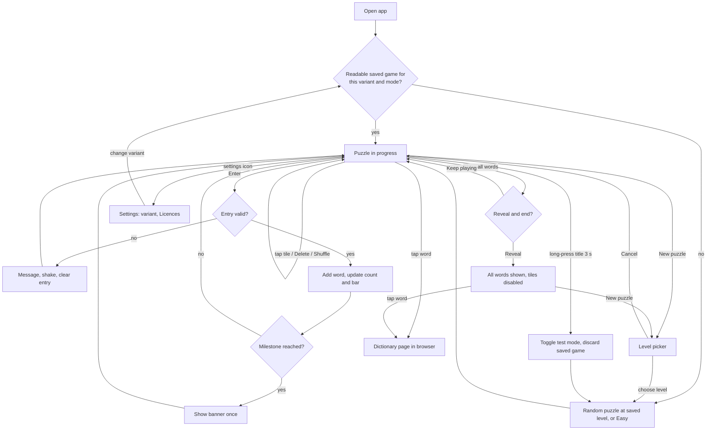

# word9: offline Flutter app with the same features as Nine Tile

## 1. Intent

Build a Flutter app for Android and iOS, named word9, that does everything the Nine Tile web app does. Apart from dictionary lookups, it works fully offline, and it has no accounts or sign-in.

## 2. Type

Feature

## 3. Context

Nine Tile is a word game delivered as two single-page web apps, one for British English[^ninetile-gb] and one for American English[^ninetile-us]. Players need a browser, and the page's fonts load from Google. word9 is the owner's own initiative, so the game can be played without a browser or a connection.

The reference behaviour is Nine Tile at commit `3543b45`:

- **Puzzle:** a 3×3 grid holds the letters of a nine-letter word, with the centre tile shaded. The centre tile stays in place, and the eight outer tiles are shuffled.
- **Rules:** words have at least 4 letters and use the centre tile, and each tile can be used once per word.
- **Levels:** Easy, Medium and Hard, each with 2,500 embedded puzzles, one picked at random.
- **Word data:** built from SCOWL[^scowl] by Nine Tile's build script[^ninetile-build]. Common words count toward a puzzle's total. Rarer words and alternative spellings are accepted when entered, but aren't part of the initial total.

## 4. Personas

| Persona | Impact | Gains | Losses |
| ------- | ------ | ----- | ------ |
| Player | Mixed | Plays on a phone or tablet with no browser, connection or account; a game in progress is restored after the app is closed. | No keyboard input; dictionary lookups still need a connection; progress isn't shared with the web app. |
| Maintainer | Mixed | A native app on both stores; test mode is available in release builds for quick checks. | Word-build rules exist in two repositories and can drift apart; store accounts and releases need upkeep. |

## 5. Constraints

**Platforms and technology**

- word9 is built with Flutter and ships on Android and iOS only.
- The minimum OS versions are Flutter's defaults at build time.
- The app is portrait only.
- On wider screens, content is centred at a maximum width of 440 pt.

**Offline and privacy**

- In airplane mode from a fresh install, every feature works except the dictionary pages. All word data and fonts are in the app package.
- The app itself makes no network requests. The only network use is the dictionary page opened in a browser when the player taps a word.
- There is no account, registration or sign-in.
- There are no analytics, ads, crash reporting or in-app purchases.

**Game parity**

Unless section 6 lists a difference, word9 matches Nine Tile at commit `3543b45` in rules, on-screen text and word validation.

- Text appears as in Nine Tile, except that the title reads "word9" instead of "NineTile". Each variant uses its own spelling ("centre" or "center").
- A submitted entry is checked in this order, and the first failure shows its message, shakes the entry and clears it:

  | Order | Check | Message |
  | ----- | ----- | ------- |
  | 1 | Fewer than 4 letters | `Too short: use at least 4 letters` |
  | 2 | Centre tile not used | `Must include the centre letter X` |
  | 3 | Word already found | `Already found` |
  | 4 | Not in the answers or accepted words | `“WORD” isn't in the word list` |

- These Nine Tile behaviours are kept deliberately:
  - An accepted word outside the answers raises the total when found, so "5 of 30" becomes "6 of 31".
  - A puzzle can repeat, as there's no play history.
  - Shuffle and Delete stay enabled after a reveal.
- The level labels stay as in Nine Tile: Easy "Up to 30 words", Medium "31 to 50 words", Hard "Over 50 words".
- Progress shows "N of M" with a bar marked at 35% and 70%.
- Each encouragement banner shows at most once per puzzle:

  | Trigger | Title | Text |
  | ------- | ----- | ---- |
  | Nine-letter word found | `You found the nine-letter word!` | `WORD uses every tile.` |
  | 35% of the total found | `Good start!` | `You have found over a third of the words.` |
  | 70% of the total found | `Great going!` | `Over two thirds found. Keep at it.` |
  | 100% of the total found | `Puzzle complete!` | `You found every word. Brilliant.` |

- When one word reaches several percentages, only the highest shows, and the nine-letter banner comes before it.
- A banner shows for 2.8 s, with a 0.3 s gap before the next one. Tapping it dismisses it.

**Look and accessibility**

- word9 uses Nine Tile's light and dark palettes, following the system theme with no in-app toggle.
- It uses Bricolage Grotesque and Atkinson Hyperlegible, and Nine Tile's one-column layout adapted to native mobile. Pixel-identical rendering isn't required.
- Animations are removed when the system's reduced-motion setting is on.
- Tiles and controls have screen-reader labels, and the centre tile is announced as the centre letter.

**Word data**

- word9 builds its own word data from SCOWL, using the same rules as Nine Tile's build script[^ninetile-build]. It doesn't read or depend on any file in the ninetile repository, so the two apps can change independently.
- Built from SCOWL 2020.12.07, word9's answers, accepted words, puzzles and test pool, plus dictionary URLs, match Nine Tile's at commit `3543b45` exactly, per variant:

  | Variant | Answers | Accepted | Puzzles | Test pool | Dictionary |
  | ------- | ------- | -------- | ------- | --------- | ---------- |
  | en-GB | 29,223 | 40,941 | 7,500 | 25 | `https://www.collinsdictionary.com/dictionary/english/` |
  | en-US | 29,270 | 41,000 | 7,500 | 25 | `https://www.merriam-webster.com/dictionary/` |

- A Licences entry in settings shows the SCOWL notice, which SCOWL's licence requires, and the font notices.

**Settings**

- The settings screen is new, as Nine Tile has none. It is opened from an icon in the header.
- Variants are labelled "English (UK)" and "English (US)".
- New text follows the active variant's spelling: "Licences" in en-GB, "Licenses" in en-US.
- Test mode applies to the whole app, not per variant.
- The last chosen level is remembered per variant.
- Each variant keeps its own saved game.

**Performance**

On a Pixel 6a and an iPhone 11, in release builds:

- Cold start to a playable grid takes at most 3 s.
- A new puzzle or variant switch takes at most 500 ms.
- A tile tap or word submission shows on screen within 100 ms.

## 6. Boundaries

Deliberate differences from Nine Tile:

- **No keyboard input.** Hardware keyboards are ignored and the on-screen keyboard never appears, so Nine Tile's typing behaviour and its Escape-to-clear shortcut aren't reproduced. Players use tiles and Delete.
- **Language is an in-app setting,** because there are no separate pages.
- **Test mode is toggled by a gesture,** because there is no URL.

Out of scope:

- Any change to the Nine Tile web app or the ninetile repository.
- Web and desktop builds of word9.
- Sharing progress or saved games between devices or with the web app.
- Importing saved games from the web app.
- Offline dictionary definitions.
- New gameplay, such as daily puzzles, statistics, hints or play history.
- Languages other than en-GB and en-US.
- A shared word-build pipeline between Nine Tile and word9 (parked for later discussion).
- Bundling Nine Tile's web fonts locally (parked for later discussion).

## 7. Edge cases

| Edge case | Expected behaviour |
| --------- | ------------------ |
| App killed mid-word | On relaunch, found words, revealed state and tile order are restored. The letters being entered and the last message are lost. |
| Saved game unreadable or corrupt | A new puzzle starts silently, at the saved level, or Easy if there is none. |
| Storage write fails | Play continues with no error message. |
| Dictionary tap with no connection | The browser shows its own error, and the game state is unaffected. |
| Test mode toggled | The current variant's saved game is discarded and a new puzzle of the matching kind starts. |
| Variant switched while test mode is on, and the target variant's saved game isn't a test puzzle (or the reverse) | That saved game is discarded and a new puzzle of the matching kind starts. |
| Level chosen while test mode is on | The new puzzle comes from the test pool, at level Easy. The tag shows "Easy puzzle · test mode". |
| Enter tapped with an empty entry | Nothing happens. |
| Delete tapped with an empty entry | Nothing happens. |
| Tile tapped after a reveal | Nothing happens; tiles are disabled. |
| Shuffle tapped with letters in the entry | The entry is cleared and the outer tiles are shuffled; the centre tile doesn't move. |
| Duplicated centre letter, entry uses only an outer tile with that letter | Rejected with the "must include the centre letter" message. |
| Player dismisses the level picker (Cancel or tap outside) | The picker closes, and the puzzle and level are unchanged. |
| Android back button while the level picker is open | The picker closes, and the puzzle and level are unchanged. |
| Android back button on the main screen or settings screen | The OS's normal back behaviour applies. |
| No saved game for the chosen variant | A new puzzle starts at that variant's last level, or Easy if there is none. |
| First launch on an en-US device | Variant is en-US. On any other locale, it is en-GB. |

## 8. User stories

### US-1: Play a puzzle by tapping

As a Player, I want to build words by tapping tiles, so that I can play with one hand and no keyboard.

**Acceptance criteria:**

- **Given** a puzzle in progress, **when** I tap a free tile, **then** its letter is added to the entry and the tile shows as used.
- **Given** letters in the entry, **when** I tap Delete, **then** the last letter is removed and its tile becomes free.
- **Given** a valid new word in the entry, **when** I tap Enter, **then** it joins the words found, the count and bar update, and the message shows `+ WORD`.
- **Given** an invalid entry, **when** I tap Enter, **then** the matching message from section 5 shows, the entry shakes and it is cleared.
- **Given** letters in the entry, **when** I tap Shuffle, **then** the entry is cleared, the outer tiles are rearranged and the centre tile doesn't move.

### US-2: Choose a level

As a Player, I want to choose a difficulty for a new puzzle, so that the game suits how much time I have.

**Acceptance criteria:**

- **Given** any game state, **when** I tap New puzzle, **then** a picker shows Easy, Medium and Hard, with the current level marked.
- **Given** the picker is open, **when** I choose a level, **then** a new random puzzle of that level starts, the choice is saved for the variant, and the message and tag show the level.
- **Given** the picker is open, **when** I cancel, **then** the current puzzle is unchanged.

### US-3: See progress and encouragement

As a Player, I want to see how far I've got, so that I keep going.

**Acceptance criteria:**

- **Given** a puzzle in progress, **when** I find a word, **then** "N of M" and the bar update, and the found words stay sorted alphabetically.
- **Given** a word takes me past 35%, 70% or 100% of the total, **when** I submit it, **then** the matching banner from section 5 shows once for that puzzle.
- **Given** I find a nine-letter word, **when** I submit it, **then** the message reads `Nine-letter word! WORD`, the nine-letter banner shows, and the word is highlighted in the list.
- **Given** a banner is showing, **when** I tap it, **then** it is dismissed.

### US-4: Reveal all words

As a Player, I want to see the words I missed, so that I can end a puzzle I'm stuck on.

**Acceptance criteria:**

- **Given** a puzzle in progress, **when** I tap Show all words, **then** I'm asked `Reveal and end this puzzle?` with Reveal and Keep playing.
- **Given** that question, **when** I tap Keep playing, **then** the puzzle continues unchanged.
- **Given** that question, **when** I tap Reveal, **then** all words show with missed ones marked, tiles are disabled, and the message reads `The nine-letter word was WORD`.

### US-5: Look up a word

As a Player, I want to look up a word, so that I can learn what it means.

**Acceptance criteria:**

- **Given** a found or revealed word, **when** I tap it with a connection, **then** the variant's dictionary page for that word opens in a browser.
- **Given** the page is closed, **when** I return to the app, **then** the game state is unchanged.

### US-6: Play offline and resume

As a Player, I want the game to work with no connection and remember my puzzle, so that I can play anywhere.

**Acceptance criteria:**

- **Given** a fresh install in airplane mode, **when** I open the app, **then** a puzzle is playable, with the bundled fonts, and no sign-in is asked for.
- **Given** a puzzle in progress, **when** the app is killed and reopened, **then** found words, revealed state, tile order, the level and banners already shown are restored.

### US-7: Choose English variant

As a Player, I want to choose UK or US English, so that the words and spelling match how I write.

**Acceptance criteria:**

- **Given** a first launch, **when** the device locale is en-US, **then** the variant is English (US); otherwise it is English (UK).
- **Given** the settings screen, opened from a header icon, **when** I choose a variant, **then** the word list, spelling and dictionary change to that variant, and the choice is kept across restarts.
- **Given** the target variant has a saved game, **when** I switch to it, **then** that game resumes; otherwise a new puzzle starts.
- **Given** the settings screen, **when** I open Licences, **then** the SCOWL and font notices show.

### US-8: Check banners with test mode

As a Maintainer, I want a hidden test mode in release builds, so that I can check the encouragement banners quickly.

**Acceptance criteria:**

- **Given** any game state, **when** I long-press the word9 title for 3 s, **then** test mode toggles and a new puzzle of the matching kind starts.
- **Given** test mode is on, **when** a puzzle starts, **then** it comes from the 25-puzzle test pool and the tag shows "Easy puzzle · test mode".
- **Given** test mode is on, **when** the app restarts, **then** test mode is still on.

## 9. Rollout

A single release, once all features are in:

- **Delivers:** the whole of this spec, for Android and iOS.
- **Audience:** first internal testers, through TestFlight and the Google Play internal track; then the public, on the App Store and Google Play.
- **Exit criteria:** all acceptance criteria pass on both platforms in an internal-track build, then the app is live on both public stores.

## 10. Prerequisites

Nothing is needed before development starts. Before internal testing:

- Apple Developer and Google Play accounts opened.
- App identifier and store listing name chosen.

## 11. User journey

Word validation order is in section 5.

## 12. Blast radius

Not applicable: new system. The ninetile repository is a read-only reference and doesn't change.

**Codebase scope:**

- `opichon/ninetile` @ `main` (`3543b45`): reference for behaviour and word-data rules.
- `opichon/word9`: new repository, empty when this spec was written. Not analysed: no code yet.

[^ninetile-build]: Nine Tile word-data build script, https://github.com/opichon/ninetile/blob/3543b45/tools/build_words.py
[^ninetile-gb]: Nine Tile web app, en-GB variant, https://github.com/opichon/ninetile/blob/3543b45/src/index.html
[^ninetile-us]: Nine Tile web app, en-US variant, https://github.com/opichon/ninetile/blob/3543b45/src/en-us/index.html
[^scowl]: SCOWL word lists, http://wordlist.aspell.net/
